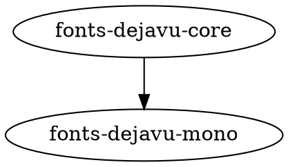

# Визуализатор зависимостей, вариант 25

## 1. Общее описание

Практическая работа №2 по конфигурационному управлению, вариант 25, язык Go.
Программа строит граф зависимостей пакета Ubuntu или граф из тестового файла.

Реализован код этапов 1–5:

- семь опций командной строки и проверка параметров;
- получение зависимостей из индекса Ubuntu `Packages` или `Packages.gz` по HTTP(S);
- выбор указанной версии исходного пакета;
- построение транзитивного графа рекурсивным DFS;
- ограничение максимальной глубины и исключение имён по подстроке;
- обработка циклов и повторных путей к одной вершине;
- режим тестового репозитория с именами из заглавных латинских букв;
- определение порядка загрузки: зависимости раньше использующих их пакетов;
- обнаружение циклов, при которых строгого порядка не существует;
- формирование описания графа на языке Graphviz DOT;
- сохранение изображения в PNG через программу Graphviz `dot`.

Код Go использует стандартную библиотеку. Для отрисовки требуется внешняя программа
Graphviz `dot`. Получение сведений о зависимостях и обход графа реализованы
самостоятельно. Программа не вызывает менеджеры пакетов. Вывод настроек,
прямых зависимостей и порядка загрузки сохранён в коммитах этапов 1, 2 и 4.
Текущая версия сохраняет PNG. Фактическое сравнение с APT из этапов 4 и 5
пока остаётся невыполненным; ниже приведены команды для этой проверки.

## 2. Функции и настройки

| Опция | Назначение | По умолчанию |
|---|---|---|
| `-package` | Имя исходного пакета | Обязательная |
| `-repository` | URL индекса Ubuntu или путь к тестовому файлу | Обязательная |
| `-test` | Работа с тестовым файлом | `false` |
| `-version` | Точная версия исходного пакета Ubuntu | Обязательная |
| `-output` | Путь к создаваемому PNG-файлу | `graph.png` |
| `-max-depth` | Максимальная глубина анализа | `3` |
| `-filter` | Подстрока для исключения имён пакетов | Пустая строка |

Имена опций, значения по умолчанию и формат текстового тестового файла выбраны
в реализации и описаны здесь. Имя пакета и версия должны быть непустыми и не
содержать пробелов, табуляций или переводов строк. Непустой фильтр имеет такое
же ограничение. Его сравнение с именем чувствительно к регистру.

Глубина является целым неотрицательным числом. Корень имеет глубину 0.
При глубине 0 результат содержит только исходный пакет. Вершины на предельной
глубине включаются в граф, но их исходящие связи не раскрываются. Если один пакет
достигнут по более короткому пути, он обрабатывается повторно с новым запасом глубины.
Циклические связи сохраняются, а повторный проход на равной или большей глубине
останавливается. Фильтр удаляет совпавшие вершины и ведущие к ним связи;
зависимости исключённого пакета через него не исследуются. Пустой фильтр отключён.
Если фильтр исключает корень, выводится сообщение о пустом графе.

В обычном режиме `-repository` задаёт прямой HTTP(S) URL файла индекса,
включая выпуск, компонент и архитектуру. Поддерживаются `Packages` и `Packages.gz`.
HTTP-запрос ограничен 30 секундами; требуется ответ `200 OK`.
Скачанный и распакованный индекс загружается в память один раз.
Формат `.xz` не поддерживается.

Версия корня выбирается точно. Для остальных имён берётся первая запись из того же
индекса. Из группы `A | B` выбирается первая альтернатива, имеющаяся в индексе
как реальный пакет или виртуальное имя из `Provides`. Для виртуального имени
берётся первый поставщик в порядке записей индекса. Квалификатор `:any` и условия
версий отделяются от имён. Проверка совместимости версий дочерних пакетов,
конфликтов и установленных пакетов в этой учебной реализации не выполняется.
Отсутствующая зависимость, до которой дошёл DFS, приводит к сообщению об ошибке.
Рекомендации `Recommends` и предложения `Suggests` не добавляются.

В тестовом режиме путь должен указывать на существующий обычный файл.
Относительный путь отсчитывается от рабочей папки процесса. Формат строки:

```text
A: B C
B:
C:
```

Каждая строка определяет пакет и его прямые зависимости. Имена состоят из
заглавных латинских букв A–Z. У пакета без зависимостей после двоеточия пусто.
Пустые строки пропускаются. Повторное описание пакета запрещено. Каждый пакет,
до которого дойдёт обход, должен иметь собственную строку, включая конечные вершины.
Тестовый формат не хранит версии: опция `-version` остаётся обязательной по схеме
запуска, но при чтении тестового графа её значение не используется.

Метод `Graph.Order` из этапа 4 сохранён: он определяет строгий порядок загрузки
для графа без циклов. Текущий CLI его не вызывает. Для визуализации порядок
загрузки не требуется, поэтому циклические связи также попадают на изображение.

Метод `Graph.DOT` формирует ориентированный граф: ребро A → B означает
«A зависит от B». Имена заключаются в кавычки, вершины перечисляются по алфавиту.
Вершины без исходящих связей тоже сохраняются. Полученный текст передаётся
на стандартный ввод `dot -Tpng -o <путь>`. Отдельный DOT-файл не создаётся.

Имя `-output` проверяется на расширение `.png`. Родительская папка должна
существовать. Относительный путь отсчитывается от рабочей папки процесса;
run.bat запускает приложение из корня проекта. Имеющийся файл PNG перезаписывается.
При отсутствии `dot` в PATH или ошибке записи программа сообщает об ошибке.
Успех: `Граф сохранён: <путь>`. Если фильтр исключил корень, PNG не создаётся.
Опция `-test` включается как `-test` или `-test=true`. Для выключения: `-test=false`.
Справка: `go run ./src -h`. Ошибки выводятся в stderr с кодом завершения 1;
успешный результат выводится в stdout с кодом 0.

Функции запуска и конфигурации:

- `main` запускает `run` и сообщает об ошибке.
- `run` получает настройки, строит граф и сохраняет PNG.
- `loadRepository` выбирает тестовый файл или индекс Ubuntu.
- `config.Parse` регистрирует и разбирает семь опций, запрещает лишние аргументы.
- `Config.Validate` проверяет значения параметров.
- `Config.validateRepository` проверяет URL либо наличие обычного тестового файла.
- `config.validToken` проверяет непустое значение без пробельных символов.

Функции индекса Ubuntu:

- `apt.Download` загружает индекс и распаковывает gzip в память.
- `apt.Fetch` сохраняет получение прямых зависимостей для кода и тестов этапа 2.
- `apt.Find` ищет одну запись по точному имени и версии.
- `apt.readFields` читает поля одной записи, включая строки продолжения.
- `apt.parseDependencies` собирает группы `Pre-Depends` и `Depends`.
- `apt.ReadGraph` читает записи индекса и выбирает версию корня.
- `apt.resolveNames` выбирает имена реальных зависимостей и альтернативы.
- `apt.recordProvides` запоминает поставщика каждого виртуального имени.
- `apt.dependencyName` отделяет имя от условия версии и квалификатора архитектуры.

Функции графа:

- `graph.Load` открывает файл тестового репозитория.
- `graph.Read` разбирает списки смежности и проверяет имена.
- `graph.validName` допускает непустые имена из A–Z.
- `graph.Build` создаёт состояние обхода и запускает рекурсивный DFS.
- `walker.visit` раскрывает вершины с учётом глубины и повторных путей.
- `walker.excluded` проверяет совпадение имени с фильтром.
- `Graph.Print` выводит списки смежности с отсортированными именами вершин.
- `Graph.Order` определяет порядок загрузки для достижимых из корня вершин.
- `ordering.visit` добавляет пакет после зависимостей и обнаруживает циклы
  по состояниям «не посещён», «в обработке», «завершён».

- `Graph.DOT` формирует описание Graphviz с отсортированными именами вершин.
- `Graph.SavePNG` запускает `dot` с DOT-текстом на stdin и проверяет результат.

`Graph.Print` и `Graph.Order` сохранены с этапов 3 и 4. CLI использует `Graph.SavePNG`.
Формирование DOT занимает O(V log V + E) времени и O(V + E) памяти при ограниченной
длине имён. Размещение элементов и растеризацию PNG выполняет внешний Graphviz.

Функции тестов:

- `TestParseValid` проверяет два корректных набора опций.
- `TestParseErrors` проверяет по одной ошибке для семи параметров.
- `TestFind` проверяет точную версию, пакет без зависимостей и отсутствие версии.
- `TestFetch` проверяет HTTP, gzip и ошибку 404 на временном локальном сервере.
- `TestBuild` проверяет цикл, повторный путь с меньшей глубиной, глубину 0 и фильтр.
- `TestReadInvalid` проверяет запрет строчных букв в тестовом файле.
- `TestReadGraph` проверяет версию корня, альтернативы и виртуальное имя.
- `sameGraph` сравнивает вершины и списки зависимостей в тестах.
- `TestOrder` проверяет общую зависимость, цепочку и отдельный пакет.
- `TestOrderCycle` проверяет ошибку при циклических зависимостях.
- `TestDOT` проверяет отдельную вершину, цикл и имена с дефисами.
- `TestSavePNG` создаёт изображение цикла и декодирует его как PNG.

## 3. Сборка, запуск и тесты

Требуются Go 1.26.2 и Graphviz с командой `dot` в PATH.
Команды выполняются из корня проекта в Windows PowerShell.
Graphviz можно получить с [официальной страницы](https://graphviz.org/download/).
При обычной установке проверь наличие папки Graphviz/bin в PATH и открой
новый терминал. Проверка:

```powershell
go version
dot -V
```

```powershell
go build -o dependency-visualizer.exe ./src
.\dependency-visualizer.exe '-test=true' '-repository=tests/repository.txt' '-package=A' '-version=1.0'
```

Запуск без отдельной сборки и через скрипт:

```powershell
go run ./src '-test=true' '-repository=tests/repository.txt' '-package=A' '-version=1.0'
.\run.bat '-test=true' '-repository=tests/repository.txt' '-package=A' '-version=1.0'
```

```powershell
gofmt -w ./src ./tests
go test -v ./...
```

Сохранены 15 сценариев первых двух этапов и шесть сценариев этапа 3.
На этапе 4 добавлены четыре сценария порядка загрузки.
На этапе 5 добавлены два сценария DOT и одна проверка настоящего PNG.
Без `dot` проверка PNG будет пропущена; для полной проверки Graphviz должен быть в PATH.
Для тестов интернет не нужен; `httptest` использует временный сервер на этом же ПК.
`tests/Packages` содержит данные проверки этапа 2. `tests/repository.txt` содержит
ветвление, общий потомок и цикл: A → B → C → D → E → F → A, а также A → D.
`tests/repository-order.txt` содержит граф без циклов и отдельный пакет F.

## 4. Примеры использования

Тестовый граф с циклом:

```powershell
$base = @('-test=true', '-repository=tests/repository.txt', '-package=A', '-version=1.0')
.\run.bat @base '-max-depth=6' '-output=cycle.png'
```

Вывод: `Граф сохранён: cycle.png`. На изображении остаются рёбра
A → B → C → D → E → F → A и A → D. При `-max-depth=0` будет только A;
при `-filter=D` останется цепочка A → B → C.

Три разных настоящих пакета Ubuntu:

```powershell
$repo = 'http://archive.ubuntu.com/ubuntu/dists/noble/main/binary-amd64/Packages.gz'
.\run.bat '-package=bash' "-repository=$repo" '-version=5.2.21-2ubuntu4' '-max-depth=3' '-output=bash.png'
.\run.bat '-package=fonts-dejavu-core' "-repository=$repo" '-version=2.37-8' '-output=fonts-dejavu-core.png'
.\run.bat '-package=fonts-dejavu-mono' "-repository=$repo" '-version=2.37-8' '-output=fonts-dejavu-mono.png'
```

Все три PNG созданы и просмотрены при подготовке этапа:

| Пакет | Результат |
|---|---|
| bash | Ветвящийся граф, общие зависимости и цикл libc6 ↔ libgcc-s1 |
| fonts-dejavu-core | Ребро fonts-dejavu-core → fonts-dejavu-mono |
| fonts-dejavu-mono | Одна вершина без исходящих зависимостей |

Полученные изображения сохраняются локально. `*.png` уже исключены через
.gitignore: по правилам оформления бинарные артефакты в коммит не добавляются.
Для защиты покажи созданные файлы и команды их получения.

Описание второго примера, которое формирует метод DOT:



Ошибки можно продемонстрировать отсутствующим пакетом или несуществующей
папкой результата:

```powershell
.\run.bat @base '-package=Z'
.\run.bat @base '-output=missing-directory/graph.png'
```

Второй пример предполагает, что missing-directory отсутствует. Программа
выводит ошибку и возвращает код 1; сразу после запуска его показывает `$LASTEXITCODE`.

### Сравнение визуализации с APT: оставшаяся проверка

APT не запускался при подготовке этого этапа. Команды ниже являются инструкцией
для Ubuntu 24.04, а не протоколом уже выполненного сравнения.
Используется штатная команда `apt-cache dotty`, формирующая граф для Graphviz.
Вывод APT применяется только при ручном сравнении; наша программа получает
зависимости самостоятельно из Packages.

В Ubuntu с установленным Graphviz:

```sh
sudo apt-get update
apt-cache policy bash fonts-dejavu-core fonts-dejavu-mono
apt-cache dotty bash > apt-bash.dot
dot -Tpng apt-bash.dot -o apt-bash.png
apt-cache dotty fonts-dejavu-core > apt-fonts-dejavu-core.dot
dot -Tpng apt-fonts-dejavu-core.dot -o apt-fonts-dejavu-core.png
apt-cache dotty fonts-dejavu-mono > apt-fonts-dejavu-mono.dot
dot -Tpng apt-fonts-dejavu-mono.dot -o apt-fonts-dejavu-mono.png
```

Сравни наборы вершин, направление и наличие связей, затем сохрани фактические
наблюдения в README. Геометрическое расположение вершин не определяет равенство
графов. По справке APT dotty различает типы пакетов формами узлов, выделяет
Pre-Depends и Conflicts. Наша программа рисует одинаковые узлы и объединяет
Pre-Depends с Depends. Она выбирает одну альтернативу и одного поставщика
виртуального имени, применяет глубину и фильтр. APT использует свои версии
и подключённые индексы, поэтому может показать другой набор связей.
В частности, наш пример bash ограничен глубиной 3, а dotty по умолчанию
продолжает рекурсию. Такой полный граф может оказаться значительно больше.
`APT::Cache::GivenOnly` у dotty ограничивает раскрываемые пакеты по списку,
но не является аналогом нашей числовой глубины.

### Сравнение порядка загрузки с APT из этапа 4

Это сравнение также пока не выполнено. В Ubuntu 24.04:

```sh
apt-get -s --no-install-recommends install fonts-dejavu-core=2.37-8
apt-get --print-uris --download-only --no-install-recommends install fonts-dejavu-core=2.37-8
```

Наша версия этапа 4 выводила `fonts-dejavu-mono -> fonts-dejavu-core`.
Последняя команда APT печатает URI архивов вместо загрузки и установки.
Строки Inst и Conf из имитации относятся к распаковке и настройке, а не скачиванию.
APT учитывает установленные пакеты и версии; наша программа этого не делает.
Порядок скачивания архивов может отличаться от строгого порядка зависимостей.
Для независимых ветвей возможно несколько допустимых порядков.

Источники:
[DOT](https://graphviz.org/doc/info/lang.html),
[команда dot](https://graphviz.org/doc/info/command.html),
[apt-cache](https://manpages.ubuntu.com/manpages/noble/man8/apt-cache.8.html),
[поля control-файлов](https://www.debian.org/doc/debian-policy/ch-controlfields.html),
[отношения между пакетами](https://www.debian.org/doc/debian-policy/ch-relationships.html).
